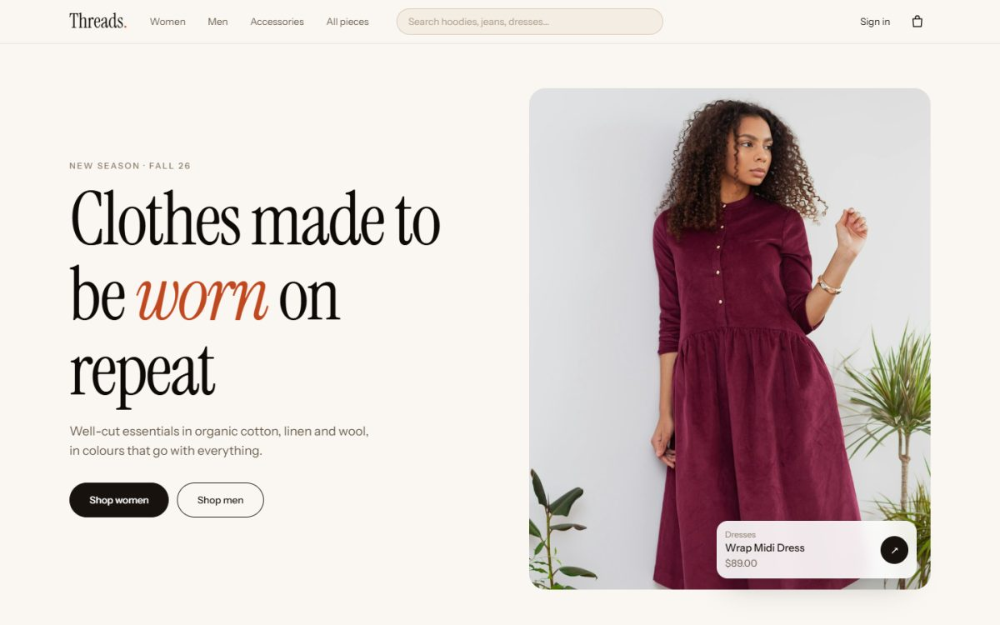
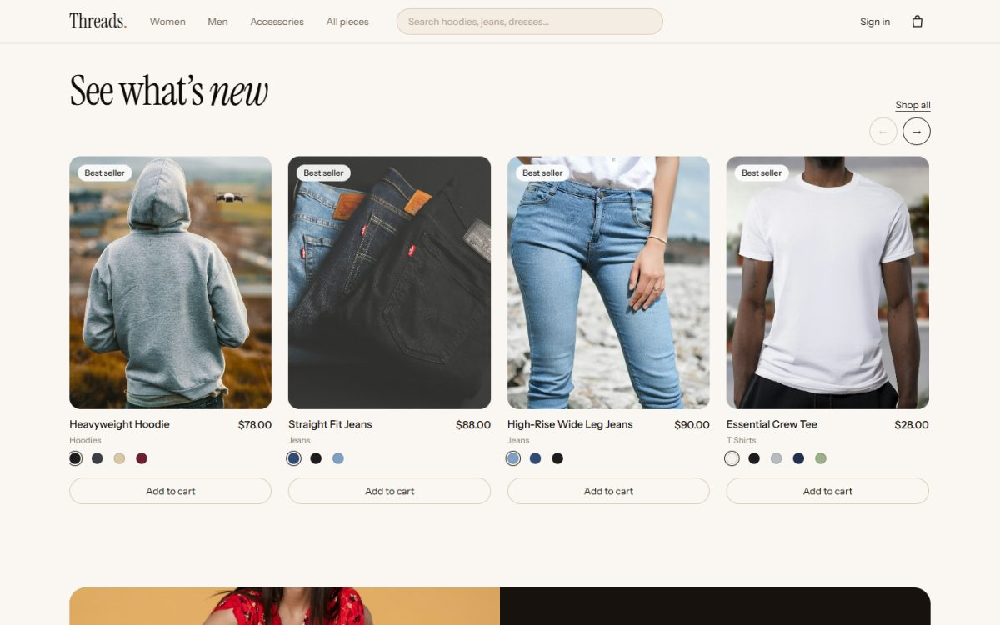
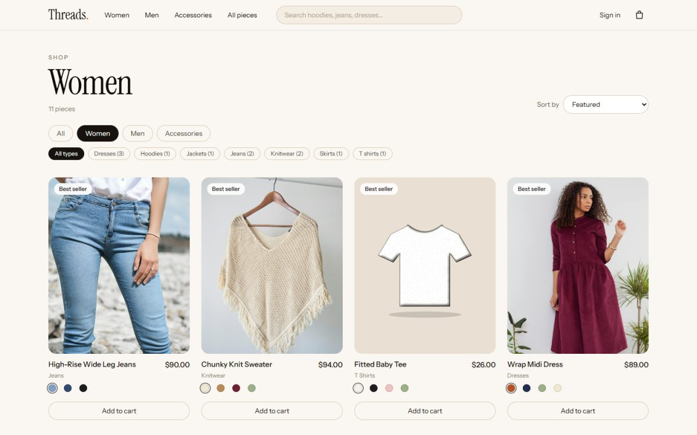
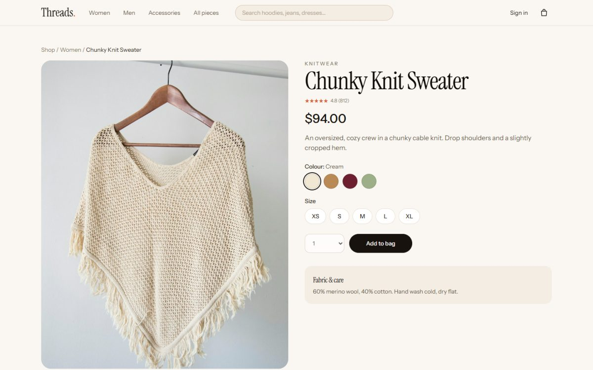
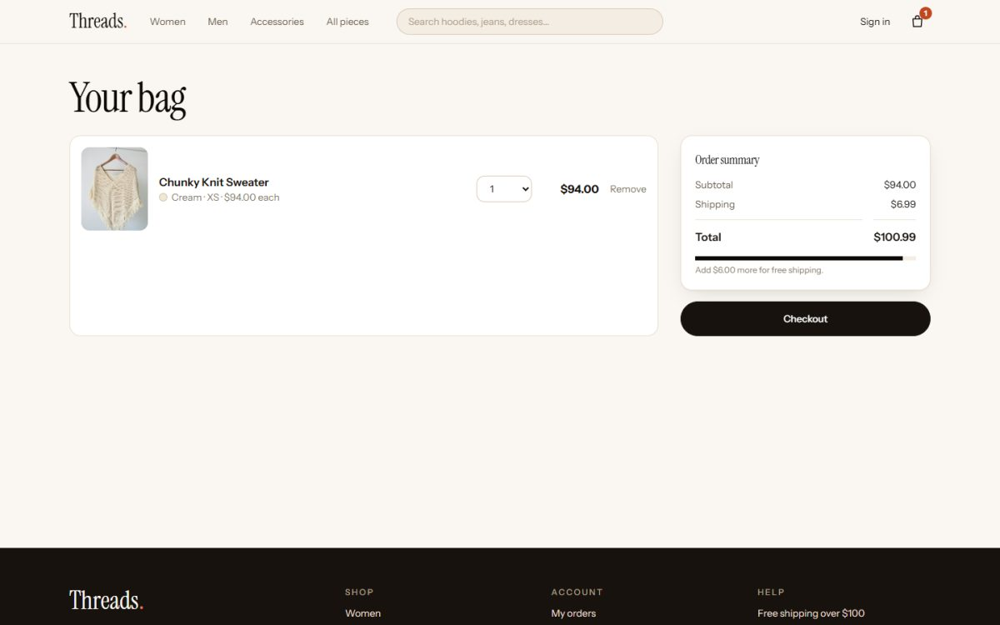
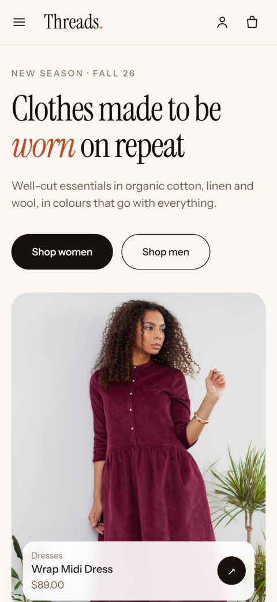
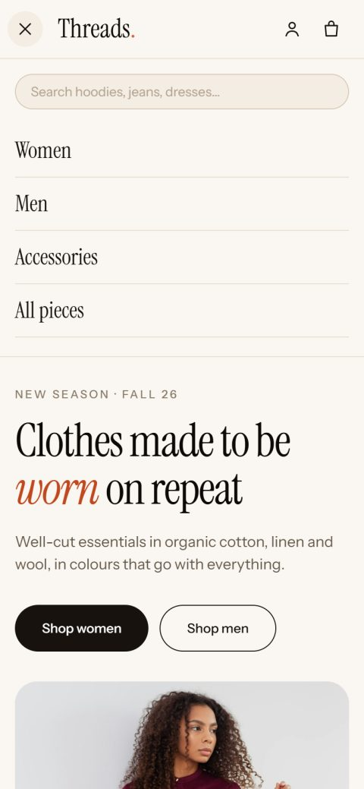
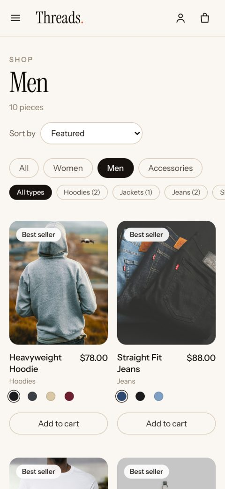
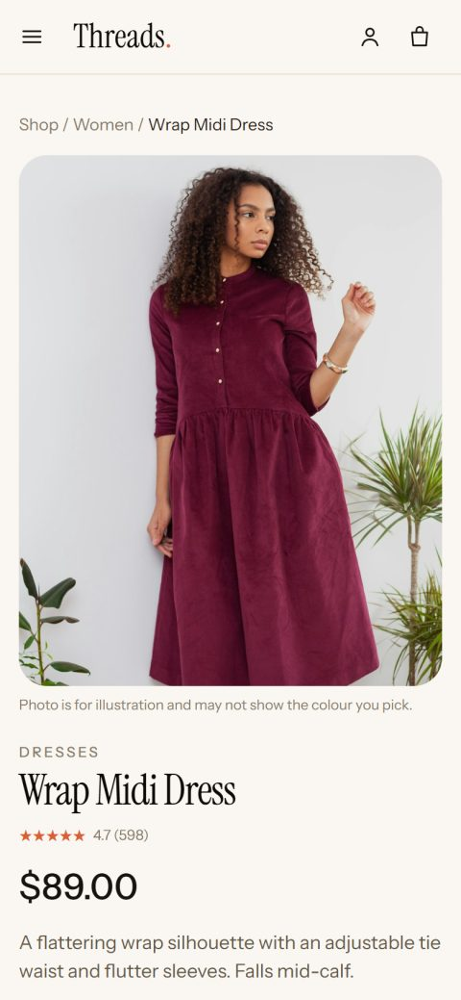

# Threads — a clothing store

A full-stack demo e-commerce site for clothing: **React** (Vite, Tailwind) on the front, **Node + Express** with a built-in **SQLite** database on the back. Everything runs on your own machine. There is nothing to sign up for and no paid service to connect.



The design follows Dribbble fashion e-commerce references: warm cream paper, near-black ink, one terracotta accent, large serif headings with italic highlights, rounded cards and real product photos. It is responsive from a 360px phone up to a wide desktop.

## Contents

- [Screenshots](#screenshots)
- [What you can do](#what-you-can-do)
- [Run it](#run-it)
- [How it works](#how-it-works)
- [Project layout](#project-layout)
- [API](#api)
- [The catalog and photos](#the-catalog-and-photos)
- [Design notes](#design-notes)
- [Limits of the demo](#limits-of-the-demo)

## Screenshots

### Desktop

| Home: "See what's new" slider | Shop, filtered to Women |
| --- | --- |
|  |  |

| Product page with colour and size pickers | Bag with free-shipping progress |
| --- | --- |
|  |  |

### Phone

| Home | Menu | Shop | Product |
| --- | --- | --- | --- |
|  |  |  |  |

## What you can do

**Browse**
- Three departments (Women, Men, Accessories) and a filter by garment type, such as jeans, hoodies or dresses, with a count next to each.
- Free-text search over name, type, department and description.
- Sort by featured, top rated, price (either way) or name. Filters live in the URL, so a filtered page can be shared or bookmarked.
- A "See what's new" slider that works by touch swipe, trackpad or the arrow buttons.

**Pick the right piece**
- Every product has colour swatches and a size picker. Stock is counted **per size and colour**, so a size that is sold out in one colour is crossed out for that colour only.
- Products with a single size, such as caps and scarves, pick it for you.
- Low stock is flagged once 5 or fewer are left ("Only 3 left in Cream, M").

**Buy**
- The bag is saved in the browser, with a progress bar toward free shipping (free over $100, otherwise a flat $6.99).
- Create an account or sign in, check out with a shipping address, and see the order afterwards with a confirmation banner.
- "My orders" lists past orders with their items, totals and shipping address.

## Run it

You need **Node 22.13 or newer**, because the database is Node's built-in `node:sqlite`. Nothing else has to be installed.

```powershell
# terminal 1: the API on http://localhost:4000
cd backend
npm install
npm run dev

# terminal 2: the site on http://localhost:5173
cd frontend
npm install
npm run dev
```

Open http://localhost:5173. Start the API first. The site sends every `/api` request to port 4000 through Vite's proxy, so the pages show a "could not reach the server" message if the API is not running.

The first start creates `backend/data/threads.db` and fills it with the catalog. After that:

| Command (in `backend`) | What it does |
| --- | --- |
| `npm run dev` | Start the API and restart it when a file changes |
| `npm start` | Start the API once |
| `npm run seed` | Wipe and reseed the catalog. It refuses if any order exists, so it can never leave an order pointing at a deleted product. Delete `data/threads.db` to start completely fresh |

| Command (in `frontend`) | What it does |
| --- | --- |
| `npm run dev` | Dev server with hot reload |
| `npm run build` | Production build into `frontend/dist` |
| `npm run preview` | Serve that build locally to check it |

Optional settings, as environment variables: `PORT` (API port, default 4000), `CORS_ORIGIN` (comma-separated allowed origins, default `http://localhost:5173`) and `JWT_SECRET` (see below).

## How it works

```
Browser (React)  ──/api──▶  Vite proxy  ──▶  Express API  ──▶  SQLite (backend/data/threads.db)
```

**Products and variants.** A product is one design (a hoodie). A *variant* is one size in one colour of it. The catalog has 25 products and 369 variants, and stock is stored on the variant. The product list API returns each product together with its variants, so the page can show which sizes are available without a second request.

**Prices are never trusted from the browser.** When you check out, the browser sends only variant ids and quantities. The server looks up the real price, checks stock, and works out shipping itself. The whole order runs inside one database transaction: if any line fails (out of stock, unknown item), nothing is written and no stock is taken. Quantities are limited to 1 to 10 per item.

**Each order line is a snapshot.** Name, colour, size and price are copied onto the order line when it is placed. Changing a price or renaming a product later does not rewrite old orders.

**Accounts.** Passwords are hashed with scrypt and a random salt, and compared in constant time. A sign-in returns a JWT valid for 7 days. A wrong email and a wrong password give the same message, so the form cannot be used to find out which emails have accounts. Sign-in and sign-up are limited to 30 attempts per 15 minutes per address.

**The JWT signing key** comes from the `JWT_SECRET` environment variable if set. Otherwise one is generated on first run and saved in `backend/data/jwt.secret`. That file and the database are git-ignored.

## Project layout

```
backend/
  src/
    index.js          Express app: CORS, JSON parsing, routes, error handler
    db.js             SQLite schema (users, products, variants, orders, order_items) and a transaction helper
    seed.js           The 25 products, their colours, sizes and stock
    auth.js           JWT signing and the sign-in-required middleware
    http.js           HttpError, the rate limiter and input checks
    routes/           products.js, auth.js, orders.js
frontend/
  public/images/products/   One photo per product, named by its slug
  src/
    App.jsx, main.jsx       Routes and providers
    api.js                  Small fetch wrapper for the API
    context/                AuthContext (user + token) and CartContext (the bag)
    components/             Header, Footer, ProductCard, ProductImage, GarmentDrawing,
                            Slider, Reveal, Stars, Status, useAsync
    pages/                  Home, Shop, ProductPage, CartPage, Checkout, Orders,
                            OrderDetail, AuthPage
    styles.css              Tailwind layers and the shared component classes
docs/screenshots/           The images in this README
```

## API

| Method | Path | Notes |
| --- | --- | --- |
| GET | `/api/health` | `{ ok: true }` |
| GET | `/api/products` | Query: `category`, `type`, `q`, `sort` (`featured`, `rating`, `price-asc`, `price-desc`, `name`), `featured=1`. Each product includes its `variants` |
| GET | `/api/products/meta` | Types per department, with counts |
| GET | `/api/products/:slug` | One product plus up to 4 `related` products |
| POST | `/api/auth/register` | `{ name, email, password }` (password at least 8 characters). Returns `{ token, user }` |
| POST | `/api/auth/login` | `{ email, password }`. Returns `{ token, user }` |
| GET | `/api/auth/me` | Needs `Authorization: Bearer <token>` |
| GET | `/api/orders` | Your orders, newest first. Needs a token |
| GET | `/api/orders/:id` | One of your orders (anyone else's gives 404) |
| POST | `/api/orders` | `{ items: [{ variantId, qty }], shipping: { name, address, city, zip } }`. Returns the new order, or 409 if stock ran out |

Errors come back as `{ "error": "message" }` with a matching status code.

## The catalog and photos

25 products: 11 for women, 10 for men and 4 accessories, from t-shirts and hoodies to jeans, dresses, knitwear, jackets, caps and bags.

- **Photos.** 20 products have a photo in `frontend/public/images/products/<slug>.jpg`, from [Unsplash](https://unsplash.com) (free to use under the Unsplash licence). Some are close matches rather than exact: the trench coat is a blue coat, the cropped hoodie is a yellow set, the tote is a wicker bag and the sweater is a crochet poncho. Replace any file with the same name to change a picture.
- **Fallback drawings.** A product with no photo shows a garment drawn as an SVG in the chosen colour (`GarmentDrawing.jsx`), lit and textured so it reads as cloth. Five products use it today: the chino shorts, baby tee, ribbed cardigan, mom jeans and wool scarf. Put `<slug>.jpg` in the images folder and the photo replaces the drawing automatically.
- **Colour swatches and photos.** A photo shows one fixed colour, so choosing a different swatch does not recolour it. The swatch still chooses the right colour and size for your bag, and the product page says the photo is for illustration.

## Design notes

- **Type:** Instrument Serif for headings (with an italic accent word) and Instrument Sans for text. Both are bundled through `@fontsource`, so the site makes no third-party font requests.
- **Colour:** a cream-to-ink scale (`brand`) and one terracotta (`accent`), defined in `frontend/tailwind.config.js`. Change those two objects to re-theme the whole site.
- **Responsive:** one page width and gutter everywhere. The header shows links and search on a laptop, drops search on a tablet and turns into a menu button on a phone. Product pages stack on a phone and become two columns with a pinned photo from tablet up. Shop filters scroll sideways on a phone instead of wrapping. Colour dots are 16px to look at but 32px to tap.
- **Motion:** gentle fade-ins and a scroll reveal, switched off for anyone whose system asks for reduced motion.

## Limits of the demo

- **Payments are a stand-in.** Placing an order marks it `paid` immediately. No card is taken and there is no payment provider.
- **No email.** The "stay in the loop" box on the home page stores nothing, and there are no order emails.
- **No admin area.** Stock and prices change by editing `backend/src/seed.js` and reseeding.
- **Shipping is one flat rule:** free over $100, otherwise $6.99.
- **One database file on one machine.** It is fine for a demo, not for running a real shop.
